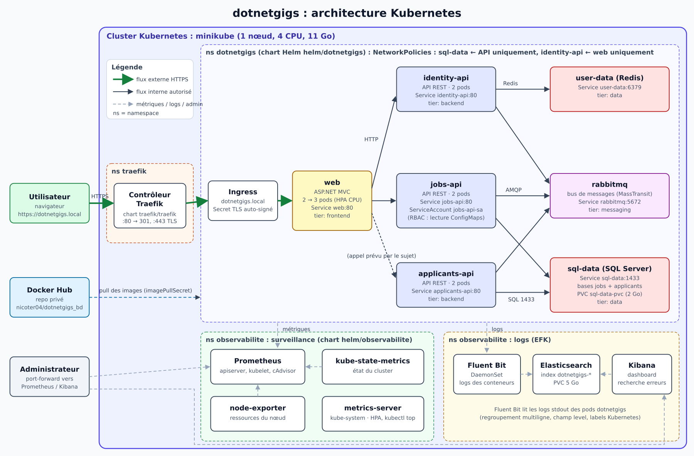

# Projet K8S : dotnetgigs sur Kubernetes

Déploiement de l'application **dotnetgigs** (site web + 3 API REST .NET, SQL Server, Redis, RabbitMQ) sur un cluster Kubernetes local (minikube), avec :

- images privées sur Docker Hub,
- accès externe **uniquement en HTTPS** (Ingress + certificat auto-signé),
- requests/limits CPU, mémoire et disque, sondes de préparation et de vivacité, affinités,
- autoscaling (HPA) de `web`,
- NetworkPolicies et ServiceAccount à droits restreints (RBAC),
- métriques avec **Prometheus** (kube-state-metrics, node-exporter, metrics-server, plan de contrôle),
- logs centralisés avec **EFK** (Elasticsearch, Fluent Bit, Kibana),
- déploiement automatisé avec un **chart Helm**.



## Sommaire

1. [Contenu du dépôt](#1-contenu-du-dépôt)
2. [Architecture](#2-architecture)
3. [Prérequis](#3-prérequis)
4. [Builder et publier les images](#4-builder-et-publier-les-images)
5. [Déployer sur un cluster vierge](#5-déployer-sur-un-cluster-vierge)
6. [Accéder aux applications](#6-accéder-aux-applications)
7. [Vérifier l'état du cluster](#7-vérifier-létat-du-cluster)
8. [Démonstrations](#8-démonstrations)
9. [Choix techniques](#9-choix-techniques)

## 1. Contenu du dépôt

```
projet_k8s/
├── appscore/                  code et Dockerfile des applications (fournis, non modifiés)
├── helm/dotnetgigs/           chart Helm de l'application (méthode de déploiement principale)
├── k8s/                       les mêmes ressources en manifestes simples (00 à 12), pour kubectl apply
├── monitoring/
│   └── prometheus-values.yaml configuration du chart prometheus-community/prometheus
├── logging/
│   ├── elasticsearch.yaml     Elasticsearch (namespace logging)
│   ├── kibana.yaml            Kibana
│   ├── fluent-bit-values.yaml configuration du chart fluent/fluent-bit
│   └── kibana-objects.ndjson  data view, recherches et dashboard Kibana (à importer)
├── scripts/
│   ├── gen-cert.sh            certificat auto-signé + Secret TLS
│   └── load-generator.yml     générateur de charge pour la démo HPA
├── docs/architecture.png      schéma d'architecture (source : architecture.svg)
├── AUTHORS.TXT
└── README.md
```

## 2. Architecture

| Application | Image | Rôle | Service (interne) | Réplicas |
|---|---|---|---|---|
| web | `nicoter04/dotnetgigs_bd:web` | site ASP.NET MVC | `web:80` | 2 → 3 (HPA) |
| jobs-api | `nicoter04/dotnetgigs_bd:jobs-api` | API offres d'emploi | `jobs-api:80` | 2 |
| applicants-api | `nicoter04/dotnetgigs_bd:applicants-api` | API candidats | `applicants-api:80` | 2 |
| identity-api | `nicoter04/dotnetgigs_bd:identity-api` | API utilisateurs | `identity-api:80` | 2 |
| sql-data | `nicoter04/dotnetgigs_bd:sql-data` | SQL Server 2017 + création des bases | `sql-data:1433` | 1 (volume persistant) |
| user-data | `redis:7-alpine` | stockage des utilisateurs | `user-data:6379` | 1 |
| rabbitmq | `rabbitmq:3-management` | bus de messages entre API | `rabbitmq:5672` | 1 |

Flux réseau :

- **Externe** : navigateur → contrôleur ingress-nginx (HTTPS 443, HTTP redirigé en 308) → Ingress `dotnetgigs.local` → `web`. C'est le seul point d'entrée : tous les Services sont en `ClusterIP`.
- **Interne** (seuls flux autorisés par les NetworkPolicies) : web → identity-api / jobs-api / applicants-api ; jobs-api, applicants-api → sql-data ; identity-api → user-data ; les 3 API → rabbitmq.

Namespaces : `dotnetgigs` (application), `ingress-nginx` (contrôleur), `monitoring` (Prometheus), `logging` (EFK).

Labels posés sur toutes les ressources : `project: dotnetgigs`, `app: <nom>`, `tier: frontend | backend | data | messaging | logging`.

## 3. Prérequis

- Docker, minikube, kubectl (ou `minikube kubectl --`), Helm 3+
- Machine ou VM : 6 CPU, 15 Go de RAM, 50 Go de disque (le projet réserve ~10 Go de mémoire)
- Un compte Docker Hub avec le repo privé `dotnetgigs_bd`

```bash
minikube start --cpus=4 --memory=11g --disk-size=40g
minikube addons enable metrics-server
minikube addons enable ingress
```

## 4. Builder et publier les images

Les Dockerfile fournis sont utilisés tels quels. Le contexte de build est `appscore/` (comme dans le `docker-compose.yml` d'origine), sauf pour SQL Server (`appscore/Database`).

```bash
cd appscore
docker build -f Web/Dockerfile                    -t nicoter04/dotnetgigs_bd:web .
docker build -f Services/Jobs.Api/Dockerfile       -t nicoter04/dotnetgigs_bd:jobs-api .
docker build -f Services/Applicants.Api/Dockerfile -t nicoter04/dotnetgigs_bd:applicants-api .
docker build -f Services/Identity.Api/Dockerfile   -t nicoter04/dotnetgigs_bd:identity-api .
docker build -t nicoter04/dotnetgigs_bd:sql-data ./Database

docker login -u nicoter04
for app in web jobs-api applicants-api identity-api sql-data; do
  docker push nicoter04/dotnetgigs_bd:$app
done
cd ..
```

Le compte Docker Hub gratuit n'autorise qu'un repo privé : les 5 images sont dans le même repo, une par tag.

## 5. Déployer sur un cluster vierge

Toutes les commandes sont lancées depuis `projet_k8s/`.

### 5.1 Namespace et secrets créés à la main

Ces deux secrets ne sont pas dans le chart : le premier contient les identifiants Docker Hub, le second la clé privée du certificat.

```bash
kubectl create namespace dotnetgigs

# Accès au repo privé (réutilise les identifiants enregistrés par "docker login")
kubectl create secret generic dockerhub-secret -n dotnetgigs \
  --from-file=.dockerconfigjson=$HOME/.docker/config.json \
  --type=kubernetes.io/dockerconfigjson

# Certificat auto-signé pour dotnetgigs.local + Secret TLS "dotnetgigs-tls"
./scripts/gen-cert.sh
```

### 5.2 Application (chart Helm)

```bash
helm upgrade --install dotnetgigs helm/dotnetgigs -n dotnetgigs
kubectl get pods -n dotnetgigs -w
```

Les API redémarrent 2 à 4 fois au premier démarrage, le temps que SQL Server et RabbitMQ soient prêts : c'est attendu. Au bout d'1 à 2 minutes, les 11 pods sont en `1/1 Running`.

Le chart contient : Secret applicatif, PVC, Deployments, Services, HPA, Ingress, NetworkPolicies, ServiceAccount/Role/RoleBinding. Il ne contient pas de contrôleur ingress. Les valeurs modifiables (repo d'images, réplicas, ressources, hôte de l'Ingress, HPA...) sont dans [helm/dotnetgigs/values.yaml](helm/dotnetgigs/values.yaml), par exemple :

```bash
helm upgrade --install dotnetgigs helm/dotnetgigs -n dotnetgigs --set ingress.host=monsite.local --set jobsApi.replicas=3
```

Variante sans Helm : `kubectl apply -f k8s/` déploie les mêmes ressources (après les secrets du 5.1).

### 5.3 Monitoring (Prometheus)

```bash
helm repo add prometheus-community https://prometheus-community.github.io/helm-charts
helm repo update
helm upgrade --install prometheus prometheus-community/prometheus --version 29.47.2 \
  -n monitoring --create-namespace -f monitoring/prometheus-values.yaml
```

### 5.4 Logs (EFK)

```bash
kubectl apply -f logging/elasticsearch.yaml
kubectl apply -f logging/kibana.yaml
helm repo add fluent https://fluent.github.io/helm-charts
helm upgrade --install fluent-bit fluent/fluent-bit --version 0.58.3 \
  -n logging -f logging/fluent-bit-values.yaml

# Quand Kibana est prêt : import du dashboard et des recherches
kubectl wait --for=condition=Ready pod -l app=kibana -n logging --timeout=300s
kubectl port-forward -n logging svc/kibana 5601:5601 &
sleep 3
curl -X POST "http://localhost:5601/api/saved_objects/_import?overwrite=true" \
  -H "kbn-xsrf: true" --form file=@logging/kibana-objects.ndjson
kill %1
```

### 5.5 Tout supprimer et redéployer de zéro

**Réinitialisation complète** (cluster recréé, état identique à un cluster vierge). Sont conservés : les images sur Docker Hub, le `docker login` (`~/.docker/config.json`) et les fichiers du dépôt.

```bash
pkill -f port-forward        # arrête les port-forward encore ouverts
minikube delete              # supprime tout le cluster : apps, volumes, monitoring, logs

minikube start --cpus=4 --memory=11g --disk-size=40g
minikube addons enable metrics-server
minikube addons enable ingress
kubectl wait --for=condition=Ready pod -l app.kubernetes.io/component=controller -n ingress-nginx --timeout=300s
```

Puis reprendre les étapes [5.1](#51-namespace-et-secrets-créés-à-la-main) à [5.4](#54-logs-efk) dans l'ordre. Au premier démarrage, minikube retélécharge toutes les images depuis Docker Hub : c'est plus long.

**Variante légère** (sans recréer le cluster) : supprime uniquement ce que le projet a installé.

```bash
helm uninstall dotnetgigs -n dotnetgigs
helm uninstall prometheus -n monitoring
helm uninstall fluent-bit -n logging
kubectl delete namespace dotnetgigs monitoring logging
```

Puis reprendre à l'étape 5.1.

## 6. Accéder aux applications

Avec le driver docker de minikube, les adresses du cluster ne sont visibles que depuis la machine qui héberge minikube. On ouvre donc un port-forward par outil (un terminal chacun) :

| Outil | Commande | URL |
|---|---|---|
| Site dotnetgigs (HTTPS) | `kubectl port-forward --address 0.0.0.0 -n ingress-nginx svc/ingress-nginx-controller 8443:443` | `https://dotnetgigs.local:8443` |
| Prometheus | `kubectl port-forward --address 0.0.0.0 -n monitoring svc/prometheus-server 9090:80` | `http://<IP>:9090` |
| Kibana | `kubectl port-forward --address 0.0.0.0 -n logging svc/kibana 5601:5601` | `http://<IP>:5601` |
| RabbitMQ (admin, optionnel) | `kubectl port-forward --address 0.0.0.0 -n dotnetgigs svc/rabbitmq 15672:15672` | `http://<IP>:15672` (guest / guest) |

`<IP>` est l'adresse de la machine qui héberge minikube. Pour le site, ajouter dans le fichier hosts du poste client (`C:\Windows\System32\drivers\etc\hosts` ou `/etc/hosts`) :

```
<IP>   dotnetgigs.local
```

Le certificat étant auto-signé, le navigateur affiche une alerte : « Avancé » → « Continuer ».

## 7. Vérifier l'état du cluster

### kubectl

```bash
kubectl get pods,svc,ingress,hpa,networkpolicy -n dotnetgigs    # application
kubectl get pods -n monitoring ; kubectl get pods -n logging     # monitoring et logs
kubectl top nodes ; kubectl top pods -n dotnetgigs               # metrics-server
kubectl describe pod -n dotnetgigs -l app=web                    # sondes, événements
kubectl logs -n dotnetgigs deploy/jobs-api --tail=20             # logs d'un service
helm list -A                                                     # releases Helm

# RBAC : jobs-api-sa lit les ConfigMaps mais rien d'autre
kubectl auth can-i get configmaps -n dotnetgigs --as=system:serviceaccount:dotnetgigs:jobs-api-sa   # yes
kubectl auth can-i list secrets  -n dotnetgigs --as=system:serviceaccount:dotnetgigs:jobs-api-sa    # no
```

### Prometheus (onglet Query)

Status → Target health : toutes les cibles doivent être `UP`.

| Métrique | Requête |
|---|---|
| État du cluster (kube-state-metrics) | `sum by (namespace) (kube_pod_status_phase{phase="Running"})` |
| Ressources des pods (cAdvisor) | `sum by (pod) (rate(container_cpu_usage_seconds_total{namespace="dotnetgigs",container!=""}[2m]))` |
| Ressources du nœud (node-exporter) | `node_memory_MemAvailable_bytes / 1e9` |
| Plan de contrôle (apiserver) | `sum(rate(apiserver_request_total[2m]))` |
| Réplicas de l'HPA | `kube_horizontalpodautoscaler_status_current_replicas{namespace="dotnetgigs"}` |

### Kibana

- **Dashboards → « Service jobs-api »** : histogramme des logs de jobs-api dans le temps par niveau + liste des logs (période par défaut : 1 h).
- **Discover → Open → « Erreurs des services (level ERROR) »** : erreurs .NET de tous les services. Pour un seul service : `level : "ERROR" and kubernetes.labels.app : "jobs-api"`.

Fluent Bit regroupe les messages .NET multilignes, retire les codes couleur et ajoute un champ `level` (`fail:` → `ERROR`, `warn:` → `WARNING`...).

## 8. Démonstrations

**Autoscaling (HPA)** :

```bash
kubectl get hpa -n dotnetgigs -w                 # terminal 1
kubectl apply -f scripts/load-generator.yml      # terminal 2 : 20 boucles de requêtes HTTPS via l'Ingress
kubectl delete -f scripts/load-generator.yml     # arrêt de la charge
```

Le CPU moyen de web dépasse 50m en ~1 minute et l'HPA passe de 2 à 3 pods ; il redescend ~5 minutes après l'arrêt.

**Logs d'erreur** : arrêter SQL Server et appeler le site, les erreurs apparaissent dans la recherche Kibana « Erreurs ».

```bash
kubectl scale deploy/sql-data -n dotnetgigs --replicas=0
# ouvrir https://dotnetgigs.local:8443 (erreur 500)
kubectl scale deploy/sql-data -n dotnetgigs --replicas=1
```

**Redémarrage automatique / sondes** : `kubectl delete pod -n dotnetgigs -l app=jobs-api` → le Deployment recrée les pods ; pendant l'arrêt de SQL Server, la readinessProbe de jobs-api (`/api/jobs`) échoue et le pod est retiré du Service jusqu'au retour de la base.

**Mise à jour sans coupure** : `helm upgrade` d'une nouvelle image → rolling update (les nouveaux pods sont prêts avant l'arrêt des anciens).

## 9. Choix techniques

- **Noms des Services** : les noms Docker Compose (`jobs.api`, `sql.data`...) contiennent un point, interdit pour un Service Kubernetes. Les Services s'appellent `jobs-api`, `sql-data`... et la configuration des apps est surchargée par variables d'environnement (`ApiSettings__JobsApiUrl`, `ConnectionString`, `RedisHost`, `HostRabbitmq`), sans modifier le code.
- **Ressources** : valeurs imposées par le sujet pour web, les API et user-data, plus `ephemeral-storage` (disque) sur tous les pods. SQL Server : 2 Gi réservés (minimum Microsoft). Les requests sont des réservations : la consommation réelle se voit avec `kubectl top pods`.
- **Sondes** : les apps n'ont pas d'endpoint `/health`. Readiness sur une route existante (`/api/jobs`, `/api/applicants`, `/Home/About`) ou en TCP ; liveness en TCP pour ne pas redémarrer une API simplement parce que la base est indisponible.
- **Affinités** : `podAffinity` en `preferredDuringScheduling` (web → jobs-api/applicants-api, jobs-api/applicants-api → sql-data, identity-api → user-data). En `required`, un pod resterait bloqué si sa cible n'est pas encore planifiée. Sur un cluster à 1 nœud elles sont toujours satisfaites ; elles prennent leur sens sur plusieurs nœuds.
- **HPA en valeur absolue** : la request CPU de web est imposée à 4m ; un objectif en pourcentage serait dépassé même sans charge. L'HPA vise donc 50m de CPU moyen par pod (`AverageValue`). Maximum 3 pods, car chaque pod web réserve 900 Mi.
- **Ordre de démarrage** : Kubernetes n'a pas de `depends_on`. Les API redémarrent tant que RabbitMQ/SQL Server ne répondent pas, puis se stabilisent.
- **Secrets hors chart** : identifiants Docker Hub et clé TLS sont créés à la main pour ne pas finir dans Git (`projet_k8s/certs/` est ignoré).
- **Elasticsearch** : 1 nœud sans sécurité (TP), santé `yellow` normale car les réplicas d'index ne peuvent pas être placés sur un seul nœud.
