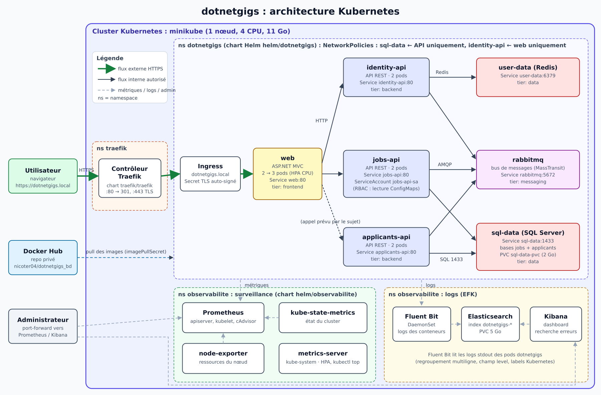

# Projet Kubernetes : dotnetgigs (version simplifiée)

Groupe : Nicolas Blin, Nolan DERUELLE (voir [AUTHORS.TXT](AUTHORS.TXT)). Sujet : [projet.md](projet.md).

On déploie sur Kubernetes (minikube) l'application **dotnetgigs** fournie par le prof :
un site web, 3 API REST, une base SQL Server, un Redis et un RabbitMQ.



## 1. Contenu du dossier

```
appscore/                  code des applications + Dockerfile fournis
helm/dotnetgigs/           chart Helm = tous les fichiers Kubernetes de l'application
  values.yaml                les 4 valeurs modifiables (image, domaine, réplicas, mot de passe)
  templates/                 un fichier par élément (web.yaml, jobs-api.yaml, ingress.yaml...)
monitoring/                réglages de Prometheus
logging/                   Elasticsearch, Kibana, Fluent Bit + dashboard Kibana
scripts/load-generator.yml pod qui génère de la charge (démo de l'HPA)
docs/architecture.png      schéma d'architecture
```

## 2. Les applications

| Application | Rôle | Image | Joignable à l'adresse (dans le cluster) |
|---|---|---|---|
| web | le site | `nicoter04/dotnetgigs_bd:web` | `web:80` (et de l'extérieur via l'Ingress) |
| jobs-api | API des offres d'emploi | `nicoter04/dotnetgigs_bd:jobs-api` | `jobs-api:80` |
| applicants-api | API des candidats | `nicoter04/dotnetgigs_bd:applicants-api` | `applicants-api:80` |
| identity-api | API d'authentification | `nicoter04/dotnetgigs_bd:identity-api` | `identity-api:80` |
| sql-data | base SQL Server | `nicoter04/dotnetgigs_bd:sql-data` | `sql-data:1433` |
| user-data | Redis (utilisateurs) | `redis:7-alpine` | `user-data:6379` |
| rabbitmq | bus de messages | `rabbitmq:3-management` | `rabbitmq:5672` |

Les noms `jobs.api`, `user.data`... du docker-compose deviennent `jobs-api`, `user-data`... :
le point est interdit dans un nom de Service Kubernetes.

## 3. Où est traitée chaque partie du sujet

| Partie du sujet | Fichier(s) | En bref |
|---|---|---|
| Conteneur | `appscore/*/Dockerfile` | images poussées dans le repo privé Docker Hub `nicoter04/dotnetgigs_bd` |
| Hébergement | `templates/*.yaml` | un Deployment + un Service par application, labels `app` et `tier` |
| Seul web ouvert à l'extérieur | `templates/ingress.yaml` | tous les Services sont internes (ClusterIP), l'Ingress expose web |
| Ressources (requests / limits) | `resources:` dans chaque Deployment | valeurs du sujet ; CPU, mémoire et disque (`ephemeral-storage`) |
| Redémarrage automatique | `livenessProbe` + Deployment | un conteneur qui ne répond plus est redémarré |
| Affinités | `affinity:` dans web, jobs-api, applicants-api, identity-api | web → API ; API → sql-data ; identity-api → user-data |
| Scalabilité | `templates/hpa.yaml` | web passe de 2 à 3 pods quand le CPU monte |
| Sondes | `readinessProbe` / `livenessProbe` | dans chaque Deployment |
| Métriques | `monitoring/prometheus-values.yaml` | Prometheus + kube-state-metrics + node-exporter + metrics-server |
| HTTPS | `templates/ingress.yaml` + étape 3 | certificat auto-signé, HTTP redirigé vers HTTPS |
| ServiceAccount + RBAC | `templates/rbac.yaml` | jobs-api ne peut que lire les ConfigMaps |
| NetworkPolicy | `templates/networkpolicy.yaml` | seules les API parlent à SQL ; seul web parle à identity-api |
| Logs (EFK) | `logging/` | Fluent Bit → Elasticsearch → Kibana (dashboard + recherche d'erreurs) |
| Helm | `helm/dotnetgigs/` | tout le déploiement en une commande, sans contrôleur d'ingress |

## 4. Builder et publier les images

Les Dockerfile fournis sont utilisés tels quels.

```bash
cd appscore
docker build -f Web/Dockerfile                    -t nicoter04/dotnetgigs_bd:web .
docker build -f Services/Jobs.Api/Dockerfile       -t nicoter04/dotnetgigs_bd:jobs-api .
docker build -f Services/Applicants.Api/Dockerfile -t nicoter04/dotnetgigs_bd:applicants-api .
docker build -f Services/Identity.Api/Dockerfile   -t nicoter04/dotnetgigs_bd:identity-api .
docker build -t nicoter04/dotnetgigs_bd:sql-data ./Database

docker login -u nicoter04
docker push nicoter04/dotnetgigs_bd:web
docker push nicoter04/dotnetgigs_bd:jobs-api
docker push nicoter04/dotnetgigs_bd:applicants-api
docker push nicoter04/dotnetgigs_bd:identity-api
docker push nicoter04/dotnetgigs_bd:sql-data
cd ..
```

Docker Hub gratuit n'autorise qu'un seul repo privé : les 5 images sont dans le même repo, avec un tag différent.

## 5. Déployer sur un cluster vierge

Prérequis : Docker, minikube, kubectl, Helm. VM conseillée : 6 CPU, 15 Go de RAM, 50 Go de disque.

**Étape 1 : démarrer le cluster**

```bash
minikube start --cpus=4 --memory=11g --disk-size=40g
minikube addons enable metrics-server     # mesure le CPU (utilisé par l'HPA)
minikube addons enable ingress            # contrôleur d'ingress (hors chart, demandé par le sujet)
```

**Étape 2 : namespace + accès au repo privé**

```bash
kubectl create namespace dotnetgigs
kubectl create secret generic dockerhub-secret -n dotnetgigs \
  --from-file=.dockerconfigjson=$HOME/.docker/config.json \
  --type=kubernetes.io/dockerconfigjson
```

Ce Secret reprend les identifiants enregistrés par `docker login`. Il n'est pas dans le chart pour ne pas mettre de mot de passe dans Git.

**Étape 3 : certificat HTTPS auto-signé**

```bash
mkdir -p certs
openssl req -x509 -nodes -newkey rsa:2048 -days 365 \
  -keyout certs/tls.key -out certs/tls.crt \
  -subj "/CN=dotnetgigs.local" -addext "subjectAltName=DNS:dotnetgigs.local"
kubectl create secret tls dotnetgigs-tls -n dotnetgigs --cert=certs/tls.crt --key=certs/tls.key
```

La première commande crée la clé privée (`tls.key`) et le certificat (`tls.crt`).
La seconde les range dans le Secret `dotnetgigs-tls` utilisé par l'Ingress.
Le dossier `certs/` n'est pas envoyé sur Git (il contient la clé privée).

**Étape 4 : l'application (Helm)**

```bash
helm upgrade --install dotnetgigs helm/dotnetgigs -n dotnetgigs
kubectl get pods -n dotnetgigs -w          # Ctrl+C pour quitter
```

Les API redémarrent 3 ou 4 fois au début : elles plantent tant que SQL Server et RabbitMQ ne sont pas prêts,
puis Kubernetes les relance automatiquement. Au bout de 2 à 3 minutes, tout est en `1/1 Running`.

**Étape 5 : Prometheus**

```bash
helm repo add prometheus-community https://prometheus-community.github.io/helm-charts
helm repo update
helm upgrade --install prometheus prometheus-community/prometheus --version 29.47.2 -n monitoring --create-namespace -f monitoring/prometheus-values.yaml
```

**Étape 6 : logs (EFK)**

```bash
kubectl apply -f logging/elasticsearch.yaml
kubectl apply -f logging/kibana.yaml
# Attendre qu'Elasticsearch soit prêt AVANT d'installer Fluent Bit (sinon les premiers logs sont perdus)
kubectl wait --for=condition=Ready pod -l app=elasticsearch -n logging --timeout=300s
helm repo add fluent https://fluent.github.io/helm-charts
helm upgrade --install fluent-bit fluent/fluent-bit --version 0.58.3 -n logging -f logging/fluent-bit-values.yaml

# Quand Kibana est prêt : import du dashboard et de la recherche d'erreurs
kubectl wait --for=condition=Ready pod -l app=kibana -n logging --timeout=300s
kubectl port-forward -n logging svc/kibana 5601:5601 &
sleep 3
curl -X POST "http://localhost:5601/api/saved_objects/_import?overwrite=true" -H "kbn-xsrf: true" --form file=@logging/kibana-objects.ndjson
kill %1
```

**Tout supprimer** : `minikube delete` (puis recommencer à l'étape 1).

## 6. Accéder aux applications

minikube tourne dans une VM : on ouvre un port-forward par outil (un terminal chacun).

| Outil | Commande | Adresse depuis le PC |
|---|---|---|
| Site (HTTPS) | `kubectl port-forward --address 0.0.0.0 -n ingress-nginx svc/ingress-nginx-controller 8443:443` | `https://dotnetgigs.local:8443` |
| Prometheus | `kubectl port-forward --address 0.0.0.0 -n monitoring svc/prometheus-server 9090:80` | `http://<IP de la VM>:9090` |
| Kibana | `kubectl port-forward --address 0.0.0.0 -n logging svc/kibana 5601:5601` | `http://<IP de la VM>:5601` |

Pour le site, ajouter dans le fichier hosts du PC (`C:\Windows\System32\drivers\etc\hosts`) :

```
<IP de la VM>   dotnetgigs.local
```

Le certificat est auto-signé : le navigateur affiche une alerte, cliquer sur « Avancé » puis « Continuer ».

## 7. Vérifier l'état du cluster

```bash
kubectl get pods,svc,ingress,hpa,networkpolicy -n dotnetgigs   # l'application
kubectl get pods -n monitoring                                  # Prometheus
kubectl get pods -n logging                                     # EFK
kubectl top pods -n dotnetgigs                                  # CPU / mémoire de chaque pod
kubectl describe pod -n dotnetgigs -l app=web                   # détail d'un pod (sondes, événements)
kubectl logs -n dotnetgigs deploy/jobs-api --tail=20            # logs d'une application
helm list -A                                                    # ce qui est installé avec Helm

# RBAC : jobs-api-sa peut lire les ConfigMaps mais pas les Secrets
kubectl auth can-i get configmaps -n dotnetgigs --as=system:serviceaccount:dotnetgigs:jobs-api-sa   # yes
kubectl auth can-i list secrets   -n dotnetgigs --as=system:serviceaccount:dotnetgigs:jobs-api-sa   # no
```

**Prometheus** : menu Status → Target health (tout doit être `UP`), puis onglet Query :

| Ce qu'on regarde | Requête |
|---|---|
| Pods en marche (état du cluster) | `sum by (namespace) (kube_pod_status_phase{phase="Running"})` |
| CPU de chaque pod | `sum by (pod) (rate(container_cpu_usage_seconds_total{namespace="dotnetgigs",container!=""}[2m]))` |
| Mémoire libre du nœud | `node_memory_MemAvailable_bytes / 1e9` |
| Plan de contrôle (requêtes à l'API Kubernetes) | `sum(rate(apiserver_request_total[2m]))` |

**Kibana** :
- Dashboards → « Service jobs-api » : les logs de jobs-api dans le temps.
- Discover → Open → « Erreurs des services (level ERROR) » : les erreurs de toutes les applications.

## 8. Démonstrations

**HPA** (2 terminaux) :

```bash
kubectl get hpa -n dotnetgigs -w                  # terminal 1 : on regarde
kubectl apply -f scripts/load-generator.yml       # terminal 2 : on lance la charge
kubectl delete -f scripts/load-generator.yml      # on arrête la charge
```

Après environ 1 minute, web passe de 2 à 3 pods. Il redescend à 2 environ 5 minutes après l'arrêt.

**Redémarrage automatique** : `kubectl delete pod -n dotnetgigs -l app=jobs-api` → les pods sont recréés tout de suite.

**NetworkPolicy** : un pod de test ne peut pas joindre SQL Server (seules les API le peuvent) :

```bash
kubectl run test --rm -it --image=busybox:1.36 -n dotnetgigs -- nc -zv -w 3 sql-data 1433
# => timeout
```

**Erreurs dans Kibana** : arrêter SQL Server, recharger le site (erreur), puis regarder la recherche « Erreurs ».

```bash
kubectl scale deploy/sql-data -n dotnetgigs --replicas=0
kubectl scale deploy/sql-data -n dotnetgigs --replicas=1
```

**Helm** : changer une valeur puis revenir en arrière.

```bash
helm upgrade dotnetgigs helm/dotnetgigs -n dotnetgigs --set apiReplicas=1   # 1 seul pod par API
helm rollback dotnetgigs 1 -n dotnetgigs                                     # retour à la version 1
```
